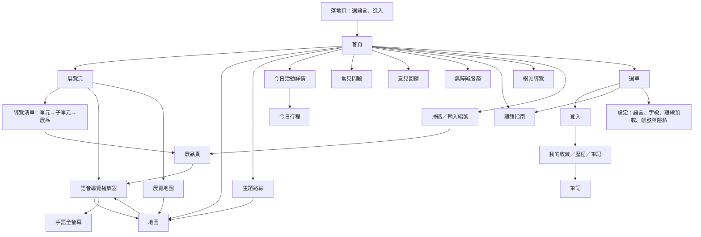

# 第 2 階段交接資料：臺史博 Web 導覽系統設計端

- 整理日：2026-11-27
- 用途：供工作報告書「整體系統規劃架構圖」（前臺、後臺、常設展手語導覽、會員服務）參考
- 原型版本：commit `9fbb9db`（2026-11-25），連結見 [prototype-links.md](prototype-links.md)
- 狀態標註（確定／暫定／未設計）為設計端初步判斷，待專案經理與館方確認

## 資料夾

| 位置 | 內容 |
|---|---|
| [prototype-links.md](prototype-links.md) | 原型連結、對應 commit、未上傳大檔位置 |
| [pages/](pages/) | 前臺頁面清單與資訊架構；後臺功能架構（畫面未設計） |
| [ai-notes/](ai-notes/) | 使用流程、功能規格、訪談簡報規格、手語對應表等 AI 協作產出 |
| [usability-tests/](usability-tests/) | 第 1 輪測試頁、回測紀錄、結果簡報、**第 1 輪後修改清單**；第 2 輪測試計畫與受測者說明 |
| [references/](references/) | 樓層平面圖、業界做法調查、樓層立體示意 |

## 1. 前臺頁面與功能清單

完整清單與階層見 [pages/前臺頁面清單與資訊架構.md](pages/前臺頁面清單與資訊架構.md)。摘要：

- **確定**：落地頁、首頁、展覽頁、導覽清單（單元→子單元→展品）、展品頁、語音播放器、掃碼／輸入編號、語言切換
- **暫定**：地圖（找設施／找展覽／找出入口／帶我去）、主題路線、離館指南、今日活動與行程、無障礙服務、常見問題、意見回饋、網站導覽、會員（登入、收藏、導覽歷程、筆記）、展品評論、字級與高對比、離線預載、帳號與隱私
- **未設計**：AI 陪伴式導覽員、真實會員登入與跨裝置同步

## 2. 頁面跳轉關係

依程式碼整理，箭頭為主要路徑；掃碼按鈕為浮動按鈕，多數頁面可用，圖中只畫一條代表線。

## 3. 後臺

**後臺畫面尚未設計，但功能架構已規劃。** 以標書（服務建議書）的後臺規劃為基底，依最新原型前臺與 11/13 決議調整。完整清單見 [pages/後臺頁面清單與資訊架構.md](pages/後臺頁面清單與資訊架構.md)，七個功能群：

- **A 內容管理**：展區與展覽、單元／子單元／展品、導覽內容與音軌、台語客語音軌、手語導覽、媒體庫、主題路線、批次匯入匯出
- **B 首頁與展示**：首頁區塊、今日活動與場次、開放時間、延伸資訊連結、常見問題
- **C 場館與地圖**：樓層底圖與點位、路徑與「帶我去」資料、QR Code 產製
- **D 品質與流程**：版本管理、多語看板與翻譯審核、審核流程、無障礙必填檢核
- **E 數據與回饋**：統計中心、意見回饋、展品評論、會員管理
- **F AI 陪伴式導覽**：AI 知識庫
- **G 系統管理**：場館設定、離線預載、權限、異動紀錄、帳號安全、外部介接 API、資料匯出

10/30 審查意見另外要求的後臺項目（新增語系多選、不當留言管理頁、登入限館方網域、Log 查詢 6 個月以上、後臺教學影片）也已併入。

依原型調整、與標書不同的主要地方：資料層級多了「單元／子單元」；展覽與活動資料改為抓取官網；地圖要管設施點位與路徑；新增展品評論管理、常見問題管理、AI 知識庫。

## 4. 11/13 協調會報決議的原型實作狀況

| 決議 | 狀況 | 說明 |
|---|---|---|
| 常設展放置展品介紹（以單元別層級） | 已實作 | 導覽清單為三層：單元總說 → 子單元 → 展品；常設展 27 件展品，各有介紹文字（2026-11-18 起） |
| 介面語言顯示規則：只顯示該語言語音 | 已實作 | 全站套用；中文介面含台語、客語音軌；英／日／韓介面只顯示各自語音 |
| 沒有對應語音只顯示文字 | 已實作 | 沒有同語言語音的內容只有展品介紹文字，無導覽內容、無播放器、無編號 |
| 手語只在中文介面 | 已實作 | 手語影片只在中文介面出現，且只走手語導覽那條線 |
| AI 陪伴式導覽：首頁 AI 可問場館問題 | **未實作** | 原型找不到任何 AI 對話介面 |
| AI 陪伴式導覽：展覽頁 AI 先開放給有語音導覽的特展 | **未實作** | 同上 |
| 首頁卡片的語言／手語標籤 | 已實作 | 展覽卡照片左上顯示該介面語言的語音標籤與手語標籤；放不下時收成「+N」 |

補充：

- 外語導覽稿目前是 AI 翻譯，介面會標示「AI 翻譯」；展品外語稿為館方譯文
- 11/13 簡報對 AI 的定義：只依後臺知識庫回答、回答標示「由 AI 產生」、查無資料時委婉回覆且不轉介服務台；時程為 12/10 定案架構、116/10/31 前完成建置

## 5. 需要後端或資料支援的功能

原型尚未接後端，下列功能在原型中都是模擬或寫死在前端，**正式實作時需要後端或資料支援**：

| 功能 | 原型現況 | 正式實作的後端／資料需求 |
|---|---|---|
| 展覽與特展資訊 | 3 檔展覽的介紹、展期寫在程式裡 | 抓取官網「展覽」資料；後臺只設「是否公告」開關（11/13 待決事項 3） |
| 今日活動、行程、開放時間 | 日期、假日、暑假規則在前端推算 | 抓取官網「開放時間」場次表；開閉館時間與休館日資料來源 |
| 單元、展品、導覽內容 | 常設展 27 件、導覽稿三層，寫在程式裡 | 內容管理（展覽 → 單元 → 子單元 → 展品）、上下架、版本；展品異動時展籤與導覽同步 |
| 語音與手語媒體 | 音檔、手語 mp4 放在靜態資源（手語取自館方 YouTube，壓成 480p） | 媒體儲存與串流（標書：手語優先 imedia）、字幕、授權管理、CDN |
| 多語切換與翻譯 | 中／英／日／韓；依語言過濾語音、手語、文字；AI 翻譯標籤 | 每則內容每種語言的語音與手語資料模型；AI 翻譯服務與審核流程；「AI 翻譯」標示開關 |
| QR Code 與掃碼 | 以網址參數深連結；掃碼用瀏覽器內建解碼 | 後臺產製 QR（展覽、展品編號、手語）、展品編號對照表、深連結路由 |
| 會員登入 | 模擬登入（程式註記正式版改接 OIDC） | 認證、帳號資料庫、個資處理、資料下載與刪除 |
| 收藏、筆記、導覽歷程 | 存瀏覽器 localStorage | 帳號資料庫；未登入資料登入後合併 |
| 續聽 | 記在瀏覽器 | 播放位置跨裝置同步 |
| 展品評論 | 登入後星等與文字，前端示意 | 評論儲存、審核或檢舉機制 |
| 意見回饋 | 前臺表單畫面 | 回饋收集、後臺篩選與回覆流程 |
| 離線預載 | 下載狀態為示意 | 離線資源包、快取範圍與版本更新 |
| 地圖與帶我去 | 底圖 PNG，點位、路徑、距離寫在前端 | 樓層底圖、設施與展品點位、路徑與跨樓層連接資料，後臺可維護 |
| 數據統計 | 無事件埋點 | GA4／GTM 事件（收聽、完聽、QR 進入、語言切換、收藏、路線完成） |
| AI 問答 | 未做 | 後臺知識庫、問答服務、回答範圍與「由 AI 產生」標示、查無資料回覆 |
| 外部介接 | 無 | RESTful API（展覽、展品、導覽內容、多語、地圖點位）、導流網址、API Key／JWT |
| 手語影片對應 | 手工對照 | 影片與展品對應關係的維護 |

## 6. 架構上要注意、或還沒想清楚的地方

1. **規格與原型有落差**：`ai-notes/uiux-specification-nmtl-webguide.md` 是 2026-10-16 的快照。原型已有、規格沒寫的：帶我去、會員、續聽、今日活動、單元別層級；規格有、原型沒做的：設施排程小助手。工程端以誰為準需要先定
2. **AI 導覽範圍與責任**：決議尚未實作。需決定知識庫來源、回答範圍（首頁問場館、展覽頁限有語音導覽的特展）、AI 翻譯稿是否經館方審核再上線
3. **語言規則是資料模型問題**：「只顯示該語言語音、無語音只顯示文字、手語只在中文」要求每件內容記錄各語言有哪些語音與手語；台語、客語歸在中文介面
4. **手語影片與展品不是一對一**：館方 YouTube 手語影片 30 支與常設展展品（館方提供的 53 件參考文稿）對不起來；對應表中 12 支名稱內容相同、16 支主題相近需館方確認、2 支找不到對應（見 `ai-notes/常設展手語影片與展品對應表.md`）。對應表內的「語音導覽文稿」是館方提供的參考內容，常設展本身不做語音導覽
5. **台語、客語音軌**：11/13 簡報建議本案不錄製、後臺預留音軌位置，但原型已示範台語音軌，需以館方確認為準
6. **會員與個資**：未登入可收藏、寫筆記，登入後要合併到帳號；需設計合併規則與「資料下載與刪除」流程
7. **離線與弱網**：音檔約 18 MB、手語影片約 118 MB，離線預載要決定快取範圍
8. **後臺畫面還沒有**：功能架構已列出，但標書約 27 張後臺畫面尚未設計；前臺需要的維護項目（單元層級、設施點位與路徑、手語對應、多語審核、評論審核）要先納入再設計
9. **素材授權**：部分展品圖取自官網專刊預覽頁，手語影片取自館方 YouTube；正式版需館方提供授權素材

## 本次未納入的資料

- **未上傳**：訪談錄音、館方文件（徵求文件、工作計畫書、導覽文稿）、需求訪談簡報、報價單與標案資料、設計系統文件（尚未定案）、原型截圖、Google 表單 Apps Script、11/13 協調會報簡報（含受訪者姓名）
- **已去識別化**：`ai-notes/nmth-deck-spec.md`、`ai-notes/nmth-interview-slides-4-and-5.md`、`usability-tests/nmth-web-guide-online-usability-test-v2.md` 的受訪者姓名已改為職稱
- **只留最終版**：使用流程（旅程地圖 v3）、功能規格（v2），已去掉版本號；舊版不上傳
- **第 1 輪原始回覆資料**：含受測者稱呼、年齡、職務與逐題文字回饋，不上傳。位置：Google 雲端硬碟「臺史博 web 導覽易用性測試」（ARTOGO 組織內部分享）。彙整結果見 `usability-tests/臺史博第 1 輪易用性測試結果.pptx`
- **第 1 輪後修改清單**：已納入 `usability-tests/第1輪後修改清單.md`（內部工單 SB-2516 匯出，已去識別化，原型進度為 11/16 狀態）
- **還缺**：第 2 輪易用性測試尚未執行（排定 2026-12-01），沒有結果資料
