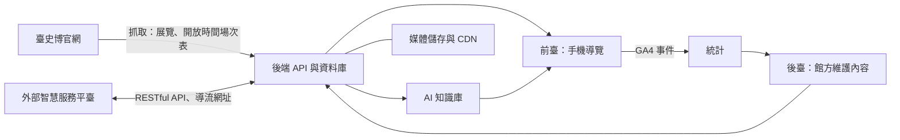

# 後臺頁面清單與資訊架構

**後臺畫面尚未設計。** 下列是後臺的功能架構，不是已完成的畫面。

- 架構基底：服務建議書（標書）的後臺規劃，頁碼為建議書印刷頁碼
- 調整依據：最新版原型前臺（commit `9fbb9db`）、11/13 協調會報決議、10/30 工作計畫書審查意見（見 `usability-tests/第1輪後修改清單.md`）
- 標書原本規劃後臺約 27 張畫面，目前一張都未設計
- 狀態是設計端的**初步標註**，待專案經理與館方確認：
  - **確定**＝標書明載，且原型前臺或 11/13 決議有對應，沒有被推翻
  - **暫定**＝標書列為待確認、或依原型／決議新增或調整，需館方確認
- 「依原型調整」表示該項與標書原文不同，或標書沒有、因前臺實作而新增

## 系統分層

標書的技術規格（建議書 p55–56、130）：前端 Next.js／React＋TypeScript；後端 Node.js LTS（Fastify 或 Express）；資料庫優先 PostgreSQL；部署於文化部共構機房（Ubuntu 24.04 LTS、Nginx）；Cloudflare CDN；API 採 RESTful、OpenAPI 3.1。

## 後臺功能架構

### A. 內容管理

| 功能 | 說明 | 依據 | 狀態 |
|---|---|---|---|
| 展區與展覽管理 | 常設展、特展的新增修改刪除、上下架、版本；依原型調整：展覽介紹、展期、展區改為抓取官網「展覽」，後臺只設「是否公告」開關 | 標書 p57、104；11/13 待決事項 3 | 暫定 |
| 單元、子單元、展品管理 | 依原型調整：資料層級為展覽 → 單元 → 子單元 → 展品（標書資料模型只到展覽 → 展品）；新增導覽精靈：基本資料 → 多語內容 → 媒體上傳 → 預覽發布 | 標書 p96–97；11/13 決議 | 確定 |
| 導覽內容與音軌 | 每則內容可有文字介紹、各語言語音、手語影片；顯示規則：介面語言只顯示該語言語音、無對應語音只顯示文字、手語只在中文介面；依原型調整：後臺要記錄每則內容、每種語言有哪些語音與手語 | 標書 p109；11/13 決議 | 確定 |
| 台語、客語音軌 | 中文介面下的語音音軌。11/13 簡報建議本案不錄製、後臺預留音軌位置；原型已示範台語音軌，待館方確認 | 11/13 待決事項 4 | 暫定 |
| 手語導覽管理 | 手語影片上架（標書：優先 imedia，指定情況 YouTube 嵌入）、影片與展品對應維護、手語專用 QR Code；依原型調整：影片與展品不是一對一，需有對應維護介面 | 標書 p118；原型 | 暫定 |
| 媒體庫 | 音檔、影片、圖片、字幕集中管理，含語系、版本、授權備註 | 標書 p57、109 | 確定 |
| 主題路線管理 | 主題路線跨展覽、展品多對多、排序；依原型調整：路線要有建議停留時間，前臺依剩餘時間排行程 | 標書 p57；原型 | 暫定 |
| 批次匯入匯出 | CSV／XLSX 多語匯入匯出、媒體批次上傳、批次上下架 | 標書 p98–99 | 確定 |
| 新增語系 | 可一次選多種語言；介面以華、英、日、韓為基礎 | 10/30 審查 #14 | 暫定 |

### B. 首頁與展示

| 功能 | 說明 | 依據 | 狀態 |
|---|---|---|---|
| 首頁區塊管理 | 標書六類區塊（展覽輪播、主題推薦、影音、圖文、純連結、公告）、排程上下架；依原型調整：首頁實際區塊為今日活動、展覽、展區地圖、主題路線、常見問題，區塊類型要對應 | 標書 p100–102；原型 | 暫定 |
| 今日活動與場次 | 11/13 簡報：抓取官網「開放時間」的場次表放進首頁「本日活動」，後臺不修改內容、只設「是否公告」開關；官網「主題活動」建議不放 | 11/13 待決事項 3 | 暫定 |
| 開放時間與休館日 | 原型首頁顯示開館時間、休館日、閉館前 30 分鐘出現離館指南，資料來源待定 | 原型 | 暫定 |
| 延伸資訊連結 | 標書規劃；依原型調整：原型已於 11/11 拿掉「延伸探索」區塊，是否保留待確認 | 標書 p103；原型 | 暫定 |
| 常見問題管理 | 依原型新增：前臺有常見問題頁；與 AI 知識庫的 Q&A 共用 | 原型；11/13 待決事項 6 | 暫定 |

### C. 場館與地圖

| 功能 | 說明 | 依據 | 狀態 |
|---|---|---|---|
| 樓層底圖與點位配置 | 標書：上傳 SVG 底圖、拖曳配置展品、展區色彩。依原型調整：原型用 PNG 底圖（1F／2F／4F／全區），另需設施點位（廁所、電梯、樓梯、出入口）、展室範圍與展名標籤、場館出入口 | 標書 p105、129；原型 | 暫定 |
| 路徑與「帶我去」資料 | 依原型新增：起訖點、步行路徑與距離、跨樓層電梯連接、方向文字 | 原型 | 暫定 |
| QR Code 產製 | 標書：系統 3 式、展覽 2 式、手語 1 式，展覽 QR 自動產生、尺寸格式容錯率可設、批次 ZIP 下載。依原型調整：原型的 QR 以網址參數進入展覽、展品編號、手語導覽；審查意見要求編號與 QR Code 分別調整、可一鍵下載，輸出樣式待與展示組協調 | 標書 p60、63、69；10/30 審查 #7；原型 | 暫定 |

### D. 品質與流程

| 功能 | 說明 | 依據 | 狀態 |
|---|---|---|---|
| 版本管理 | 每次儲存保留歷史版本，可比對與還原 | 標書 p104、106 | 確定 |
| 多語看板與翻譯審核 | 草稿／待審／已審／上架狀態；11/13 決議：介面固定文字由 ARTOGO 以 AI 翻譯並人工審核；展覽與展品介紹預設標示「AI 翻譯」、館方審核後可取消；活動資訊一律標示 | 標書 p107–108；11/13 待決事項 5 | 確定 |
| 審核流程 | 送審、通過、退回 | 標書 p108 | 確定 |
| 無障礙必填檢核 | 缺替代文字、逐字稿時不能送出 | 標書 p97 | 確定 |

### E. 數據與回饋

| 功能 | 說明 | 依據 | 狀態 |
|---|---|---|---|
| 統計中心 | 造訪、瀏覽、收聽、完聽率、語系、手語觀看、主題路線完成率；GA4＋GTM 事件。原型尚無事件埋點 | 標書 p114 | 確定 |
| 意見回饋管理 | 篩選匯出、標記已讀、回覆或轉工單；前臺已有意見回饋頁，回覆方式待確認 | 標書 p124、126 | 暫定 |
| 展品評論與不當留言管理 | 依原型新增：前臺登入後可給星等與文字，送出後顯示「審核中」；標書沒有，審查意見要求有不當留言管理頁 | 原型；10/30 審查 #20 | 暫定 |
| 會員管理 | 會員列表、遮罩 Email、停用、處理刪除申請（30 日內）；依原型：會員有收藏、導覽歷程、筆記、評論、資料下載與刪除 | 標書 p127；原型 | 暫定 |

### F. AI 陪伴式導覽

| 功能 | 說明 | 依據 | 狀態 |
|---|---|---|---|
| AI 知識庫 | 以展覽為單位匯入展覽與展品文字、圖片說明、語音導覽稿、館內定期活動、常見 Q&A；只收後臺資料、不上網搜尋；前臺回答標示「由 AI 產生」；查無資料有固定回覆文案；保固期間與館方共同調校 | 標書 p66、156；11/13 待決事項 6 | 確定（前臺與後臺畫面皆未設計） |

### G. 系統管理

| 功能 | 說明 | 依據 | 狀態 |
|---|---|---|---|
| 場館設定 | 標書只列選單、欄位未展開 | 標書 p95 | 暫定 |
| 離線預載管理 | 標書側欄項目；原型設定頁有離線預載（示意） | 標書 p95；原型 | 暫定 |
| 權限管理 | 系統管理者、內容管理者、內容編輯者、檢視者四角色，可細到展覽層級；後臺帳號與前臺會員分開管理。審查意見補充：內容編輯者只看得到負責的展覽、沒有刪除按鈕，檢視者只能查詢，帳號申請流程未定 | 標書 p110；10/30 審查 #25 | 確定（帳號申請流程待定） |
| 異動紀錄 | 記錄操作者、時間、IP、對象、動作、異動前後差異，唯寫不可竄改；審查意見要求後臺可直接查 6 個月以上的登入與操作紀錄 | 標書 p111；10/30 審查 #29 | 確定 |
| 帳號安全與後臺登入 | 密碼規則、錯誤鎖定、閒置登出、異常登入通知；數值需與文化部規定對齊；審查意見要求登入頁只開放館方網域，被擋下時要有提示 | 標書 p112–113；10/30 審查 #26 | 確定 |
| 外部介接 | RESTful API（OpenAPI 3.1）：展覽、展品、導覽內容、多語內容、地圖點位；導流網址帶展覽代碼、展品代碼、語系；API Key／JWT | 標書 p128 | 確定 |
| 資料匯出與移轉 | API 或後臺匯出 JSON／CSV／XLSX；媒體存檔案系統、不存資料庫 | 標書 p129 | 確定 |
| 後臺教學短影片 | 關鍵操作步驟旁放影片入口 | 10/30 審查 #5 | 暫定 |
